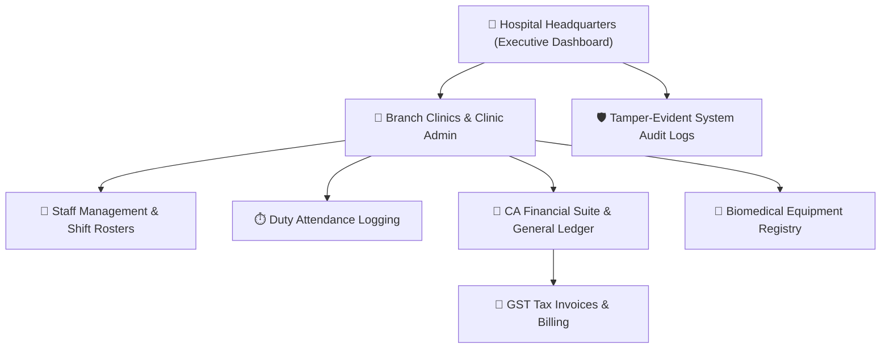

# 🏥 Jeevika Healthcare — The Connected Hospital Operating System

<div align="center">

[](package.json)
[](frontend/website)
[](backend)
[](frontend/website/tailwind.config.js)
[](LICENSE)

**One cohesive operating system connecting hospital governance, clinical oversight, clinic operations, and staff workflows.**

[Architecture](#-system-architecture) • [Features](#-core-operations-modules) • [Tech Stack](#-technology-stack) • [Quick Start](#-quick-start) • [Roadmap](#-milestone-roadmap)

</div>

---

## 📌 Project Overview

**Jeevika Healthcare** is an enterprise-grade hospital operating system designed to eliminate fragmented medical operations. Modern clinics and multi-specialty hospitals often suffer from disjointed handoffs between administrative headquarters, branch clinics, finance, and human resources. 

Jeevika unites these core administrative operations into a single deterministic, audit-logged multi-tenant platform.



---

## 🚀 Core Operations Modules (Milestone 1)

### 1. Multi-Tenant Governance & Command Center
- **Hospital Headquarters Dashboard (`HospitalDashboard.tsx`)**: Executive bird's-eye view tracking multi-clinic bed capacity, active outpatient queues, revenue streams, and emergency flags.
- **Clinic Administration (`ClinicAdminDashboard.tsx`)**: Specialized drill-down portal for branch clinic managers to review day-to-day operations and department metrics.
- **Super Admin Governance (`SuperAdminDashboard.tsx`)**: Network-level oversight across hospital registrations, clinic linkages, and system-wide telemetry.
- **Hospital Registry & Details (`HospitalsRegistry.tsx`, `HospitalDetails.tsx`)**: Complete catalog and inspection view for multi-facility networks.

### 2. Human Resources & Workforce Management
- **Staff Portal (`StaffPortal.tsx`)**: Central directory of clinicians, nurses, pharmacists, and administrators with role-based access control (RBAC).
- **Shift Rostering (`ShiftManagement.tsx`, `HospitalShiftManagement.tsx`)**: Dynamic morning, evening, and night shift scheduling across departments.
- **Duty Attendance Tracking (`ClinicAttendance.tsx`)**: Real-time staff check-in, presence tracking, and duty logs.

### 3. Financial Intelligence & Accounting
- **CA Financial Suite (`CAFinancialSuite.tsx`)**: Comprehensive ledger, trial balance, and balance-sheet generator tailored for chartered accountants.
- **Earnings & Payouts (`EarningsDashboard.tsx`)**: Transparent revenue share calculations, consultation fees, and doctor disbursements.
- **Expense Tracking (`ExpensesDashboard.tsx`)**: Clinic-level overheads, operational expenses, and procurement cost monitoring.
- **GST Invoicing & Billing (`TaxInvoice.tsx`, `BillingOverview.tsx`, `SubscriptionDashboard.tsx`)**: Standardized tax invoices with CGST/SGST breakdowns and subscription billing.

### 4. Facility Maintenance & System Compliance
- **Equipment Management (`EquipmentsDashboard.tsx`)**: Biomedical asset registry, calibration schedules, and maintenance alerts.
- **Tamper-Evident Audit Logs (`AuditLogs.tsx`)**: Immutable event logging tracking administrative logins, role modifications, and system configuration updates.
- **Settings & Localization (`SettingsDashboard.tsx`, `WebsiteLanguageSelect.tsx`)**: Multi-lingual interface support (English, Hindi, Tamil, Telugu, Punjabi) and clinic profiling.

---

## 🛠️ Technology Stack

| Layer | Technologies |
| :--- | :--- |
| **Frontend** | React 18, Vite, TypeScript, Tailwind CSS, Lucide Icons, Framer Motion, Radix UI |
| **Backend API** | Hono, TypeScript, Cloudflare Workers / Local Node Runtime |
| **Persistence** | Cloudflare D1 (SQLite-compatible edge database), Multi-tenant tenancy layer |
| **Contracts** | Zod schemas, TypeScript strict mode, OpenAPI specifications |
| **Styling & Design** | Custom Jeevika Healthcare Design System, responsive mobile-first layouts |

---

## 💻 Quick Start

### Prerequisites
- **Node.js**: `>= 20.x`
- **npm**: `>= 10.x`

### 1. Start the Local API Server
```bash
# Start the local Hono API & SQLite migrations
npm run dev:api
```
*API will be listening on `http://127.0.0.1:8790`.*

### 2. Start the Frontend Website
```bash
# Start Vite development server
npm run dev
```
*Frontend will be live at `http://localhost:5174/`.*

### 3. Production Build
```bash
npm run build
```

---

## 🗺️ Milestone Roadmap

- [x] **Milestone 1 (Current - 25%)**: Platform foundation, authentication, public marketing portal, and complete hospital administration suite.
- [ ] **Milestone 2 (+25% -> 50%)**: Clinical care ecosystem (Patient Kiosk with Voice Input, Emergency Triage, Doctor Consultation Workspace with SOAP notes & prescriptions, IPD Inpatients, Pharmacy POS & FEFO Inventory).
- [ ] **Milestone 3 (Phase 2 -> 100%)**: Cross-platform Flutter Mobile Application, BreathSense VOC cancer detection research, CBC hematology machine learning models, and Vitalis healthspan engine.

---

## 📄 License
This project is licensed under the MIT License — see the [LICENSE](LICENSE) file for details.
