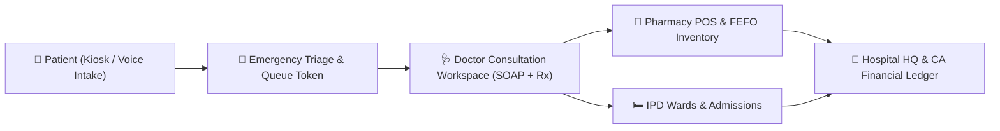

# 🏥 Jeevika Healthcare — The Connected Hospital Operating System

<div align="center">

[](package.json)
[](frontend/website)
[](backend)
[](frontend/website/tailwind.config.js)
[](docs/PROGRESS.md)
[](LICENSE)

**One cohesive operating system connecting patient intake, clinical review, inpatient care, pharmacy dispensing, hospital governance, and staff workflows.**

[Architecture](#-system-architecture) • [Features](#-system-modules) • [Tech Stack](#-technology-stack) • [Quick Start](#-quick-start) • [Roadmap](#-milestone-roadmap)

</div>

---

## 📌 Project Overview

**Jeevika Healthcare** is an enterprise-grade hospital operating system designed to eliminate fragmented medical operations. Modern clinics and multi-specialty hospitals often suffer from disjointed handoffs between intake kiosks, doctors, pharmacies, and administrative headquarters. 

Jeevika unites the entire continuum of care into a single deterministic, audit-logged multi-tenant platform.



---

## 🚀 System Modules (50% Milestone Complete)

### 1. Patient Front-Office & Emergency Services
- **Multilingual Patient Kiosk (`PatientKiosk.tsx`)**: Vernacular self-registration, symptom checklist, and real-time patient queue token assignment.
- **Voice-Assisted Symptom Capture (`VoiceInput.tsx`)**: Speech-to-text recording supporting regional languages for accessible patient onboarding.
- **Emergency Acuity Triage (`EmergencyTriage.tsx`)**: Acuity level scoring (ESI 1-5), vital parameter screening, and instant priority physician allocation.

### 2. Clinical Care & Inpatient Management
- **Doctor Consultation Workspace (`DoctorConsultation.tsx`)**: Comprehensive clinical portal with live patient queue, subjective/objective assessment (SOAP), diagnosis coding, and digital prescription builder with automated dosage logic.
- **Inpatient Department (`IPDDashboard.tsx`)**: Real-time bed occupancy matrix, ward allocation, admission/discharge workflows, and inpatient vitals monitoring.
- **AYUSH Integrative Center (`AyushDashboard.tsx`)**: Holistic medical workflows integrating Ayurveda, Yoga, Unani, Siddha, and Homeopathy treatment protocols.

### 3. Pharmacy, POS & Supply Chain
- **Pharmacy Point of Sale (`POSDashboard.tsx`)**: Rapid dispensing checkout counter, automated generic drug alternatives, and instant bill generation.
- **Inventory & FEFO Batch Control (`InventoryDashboard.tsx`)**: First-Expiry-First-Out dispensing logic, low stock alerts, batch expiry forecasting, and stock movements.
- **Central Procurement (`ProcurementDashboard.tsx`)**: Supplier purchase orders, receiving logs, and hospital vendor management.
- **Medicine Catalog Migration (`MedicineMigration.tsx`)**: Standardized drug database indexing and inventory normalization.

### 4. Hospital Governance & Administrative Command Center
- **Hospital Headquarters Dashboard (`HospitalDashboard.tsx`)**: Multi-clinic oversight, bed capacity, revenue streams, and emergency flags.
- **Clinic Administration (`ClinicAdminDashboard.tsx`)**: Branch clinic management and operational metrics.
- **Super Admin Governance (`SuperAdminDashboard.tsx`)**: Multi-tenant institutional network registry.

### 5. Workforce & Financial Suite
- **Staff Directory & Shifts (`StaffPortal.tsx`, `ShiftManagement.tsx`)**: Role-based access control (RBAC) and roster scheduling.
- **Duty Attendance Tracking (`ClinicAttendance.tsx`)**: Daily staff check-in, presence tracking, and duty logs.
- **CA Financial Suite (`CAFinancialSuite.tsx`, `TaxInvoice.tsx`)**: Chartered Accountant general ledger, trial balance, GST invoices, and earnings analytics.

---

## 🛠️ Technology Stack

| Layer | Technologies |
| :--- | :--- |
| **Frontend** | React 18, Vite, TypeScript (Strict), Tailwind CSS, Lucide Icons, Framer Motion, Radix UI |
| **Backend API** | Hono Framework, TypeScript, Cloudflare Workers / Local Node Runtime |
| **Persistence** | Cloudflare D1 (SQLite-compatible edge database), Multi-tenant tenancy layer |
| **Contracts** | Zod schemas, TypeScript strict contracts, OpenAPI specifications |
| **Styling & Design** | Custom Jeevika Healthcare Design System, responsive mobile-first layouts |

---

## 💻 Quick Start

### 1. Start the Local API Server
```bash
npm run dev:api
```
*API will be listening on `http://127.0.0.1:8790`.*

### 2. Start the Frontend Website
```bash
npm run dev
```
*Frontend will be live at `http://localhost:5174/`.*

### 3. Production Build
```bash
npm run build
```

---

## 🗺️ Milestone Roadmap

- [x] **Milestone 1 (25%)**: Platform foundation, authentication, public marketing portal, and complete hospital administration suite.
- [x] **Milestone 2 (+25% -> 50%)**: Clinical care ecosystem (Patient Kiosk with Voice Input, Emergency Triage, Doctor Consultation Workspace with SOAP notes & prescriptions, IPD Inpatients, Pharmacy POS & FEFO Inventory).
- [ ] **Milestone 3 (Phase 2 -> 100%)**: Cross-platform Flutter Mobile Application, BreathSense VOC cancer detection research, CBC hematology machine learning models, and Vitalis healthspan engine.

---

## 📄 License
This project is licensed under the MIT License — see the [LICENSE](LICENSE) file for details.
