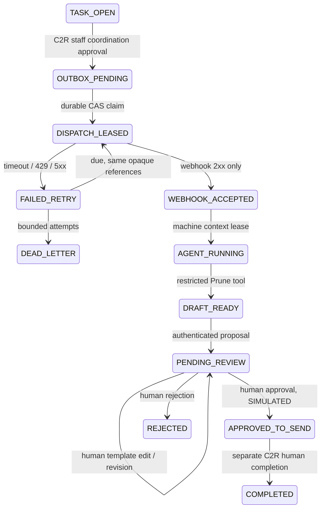

# C4 frozen workflow and C5 API contract

Version 1, synthetic P-1042 only. Frozen before implementation. No live vendor
calls or deployment authorized by this task.

Task status stays open/in_progress/completed/cancelled. Outbox delivered means
webhook accepted, never patient contact. Policy receipts remain distinct from
vendor Prune audits. Additive 0010 companion tables hold workflow/draft states,
leases, append-only events, nonce bindings and human reviews. Urgent input or task
cancellation invalidates future coordination. No autonomous clinical action.

Staff routes require stored session, explicit ENABLE_SYNTHETIC_CAREOPS_DEMO=true
and CAREOPS_SYNTHETIC_ORGS allowlist; no default production access. Read roles:
DOCTOR/NURSE/HOSPITAL_ADMIN; draft review: DOCTOR/NURSE; dispatch: HOSPITAL_ADMIN.

- GET /api/v1/careops/tasks?limit=20&cursor=UUID: items, nextCursor. Keyset by task UUID.
- GET /api/v1/careops/tasks/:id: task, workflow, draft (generic text, revision,
  receipt status), bounded redacted events/thread; cost=null, messaging=SIMULATED.
- POST /api/v1/careops/dispatch: strict {limit:1..2}; requires additional external
  dispatch flag and vendor bindings. No configured provider => no network.
- POST /api/v1/careops/tasks/:id/draft/review: Idempotency-Key UUID and shared
  careopsDraftReviewSchema. Edit selects a server-owned language template only.
  Exact replay returns recorded revision; conflicting replay/concurrent edit 409.
  Also accepted by existing /api/v1/home/nurse/tasks/:id/status with kind=draft_review.

C3 machine schemas remain canonical in packages/shared/maritime-coordination.ts:
POST /api/v1/machine/maritime/{context,draft,events}. Callback alias POST
/api/v1/careops/maritime/callback accepts the same proposal/diagnostic schema.
Bearer is a separately provisioned machine credential, not the Maritime invoke
secret or a staff session. Format org.mch_<32+ URL-safe random chars>; store only
SHA256 hash in careops_machine_credentials with expiration/revocation. Prefix is
untrusted until tenant-scoped credential lookup succeeds. No credential mint API.
All calls require X-Jeevika-Timestamp (Unix seconds, +/-300s) and
X-Jeevika-Nonce (UUID), bound to path/body/timestamp; changed nonce reuse fails.
Exact replays remain idempotent, but never bypass expiry, urgent or review checks.
Context returns opaque expiring lease, language and administrative booleans only;
draft returns opaque ref and actual receipt status, never text. Proposal means
PENDING_REVIEW; no approval or patient messaging authority.

Dispatch uses fixed Maritime webhook host and X-Maritime-Webhook-Token, opaque C3
payload only, no redirects, 8s timeout. Durable 30s claims, max 5 attempts, jittered
backoff and Retry-After. Crash uncertainty reuses IDs; app dedup does not claim
vendor exactly-once. Expired agent leases can redrive accepted webhooks. Prune
uncertain calls degrade to a deterministic template instead of duplicate billing.
Provider response text is unavailable while receipt verification remains
OFFLINE_MATH_ONLY. Signed-receipt presence alone never grants verified status.
Scheduled dispatch uses explicit CAREOPS_SYNTHETIC_ORGS inventory and the same
flags; this change provisions no cron, queues, credentials or deployment.

Reference docs checked: https://maritime.sh/docs/api,
https://maritime.sh/docs/frameworks/custom,
https://www.withprune.com/docs/receipts, https://www.withprune.com/docs/hackathon.

Human edits carry textSource=HUMAN_TEMPLATE and immutable review snapshots. The
provider/receipt status always describes the INITIAL_DRAFT, not a signature over
an edited revision. Review notes are internal only and omitted from read APIs.
Audit/thread lists are capped at 100; auditTruncated signals truncation. UUID
keyset pagination orders by ID, not chronology. Production login is unchanged;
preview requires already provisioned sessions plus the explicit synthetic gates.

Network race limit: an already in-flight generic request cannot be recalled by a
new urgent observation. SQL triggers invalidate subsequent leases, tools,
proposals and reviews immediately; no clinical data was in that request. No
exactly-once vendor delivery or production/clinical certification is claimed.

Cloudflare workerd rejects fetch redirect="error" before network. Both the C4
adapter and the reused Prune Guardian use redirect="manual" and reject non-2xx,
so no redirected request is sent. This is the smallest required C2 correction.
